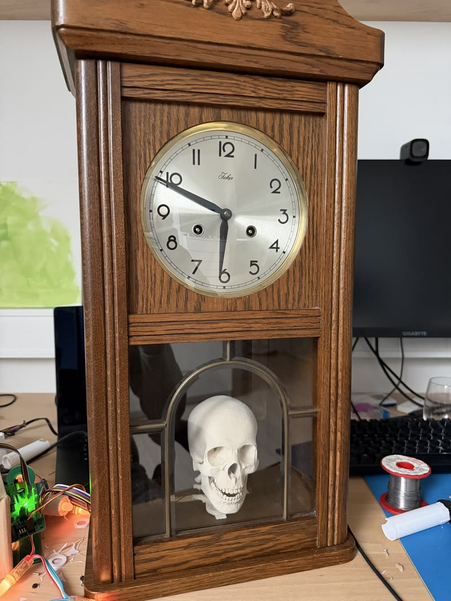

# Knekelbeen 💀

<p align="center"></p>

Een pratende Halloween-schedel die in de slingerkast van een oude wandklok
woont. Hij praat in het Nederlands met de kinderen aan de deur, beweegt zijn
kaak mee met wat hij zegt, kijkt rond, laat zijn ogen gloeien en zet de kaarsen
om hem heen aan het flakkeren. Komt er iemand aan, dan begroet hij die zelf.

```
 kinderen ──► microfoon in de klok ──► schedel (ESP32-S3) ──wifi──► laptop-app ──► Gemini Live
                                            ▲                                          │
 kaak · ogen · kaarsen · nek ◄── speaker ◄──┴──────────── stem (audio over UDP) ◄──────┘
```

De schedel zelf doet de hardware: geluid afspelen, de servo's, de leds, de
microfoon en de sensor. Het denken gebeurt in de laptop-app, die het geluid
doorstuurt naar Gemini en het antwoord terugstuurt naar de schedel. Zonder
laptop werkt hij ook: dan speelt hij de clips van de SD-kaart af.

## Wat hij kan

- **Praten met de AI:** Gemini Live hoort de kinderen en antwoordt meteen
  hardop. Je kunt kiezen uit de Gemini-stemmen of de zelf ontworpen stem
  "Knekelbeen". Zijn karakter staat in [`brain/persona.txt`](brain/persona.txt),
  zijn moppen in [`brain/jokes.txt`](brain/jokes.txt). Hij luistert alleen naar
  Nederlands en weet dat kinderen niet altijd duidelijk praten.
- **Kaak:** volgt het volume van de stem, met een zachte veerbeweging zodat hij
  niet tegen de aanslag klapt.
- **Hoofd draaien:** kijkt af en toe opzij tijdens het praten.
- **Ogen en kaarsen:** WS2812-ogen en een snoer WS2801-kaarsen die meeflakkeren
  met de stem. Een extra ledje of ledstrip kan op LED 2.
- **Soundboard:** clips en geluidseffecten (klokslag, middernacht, onweer,
  wind, hartslag, krakende deur, uil) op de SD-kaart, met een knop per geluid.
  Effecten (`fx_*.wav`) bewegen de kaak niet.
- **Bezoekers merken:** een PIR- of radarsensor op de PIR-aansluiting laat de
  ogen flitsen en de AI een groet uitspreken.
- **Eigen microfoon:** een INMP441 in de klok, zodat de laptop niet bij de deur
  hoeft te staan.

## Hardware

Een eigen printplaat ([`pcb/`](pcb/)) met een ESP32-S3-DevKitC-1 (N8R8) erop
geprikt. Alles wat van de print af gaat, zit aan een schroefklem.

| Onderdeel | Pin(nen) | Aansluiting |
|---|---|---|
| Kaakservo | GPIO 4 | KAAK |
| Draaiservo (nek) | GPIO 8 | DRAAI |
| Ogen, WS2812 | GPIO 15 | OGEN |
| Kaarsen, WS2801 | data 11, klok 12 | KAARSEN |
| LED 2, WS2812 | GPIO 48 | LED 2 |
| PIR of radar | GPIO 2 (hoog = beweging) | PIR |
| 2× versterker DFR0954 (I2S) | BCLK 5, LRC 6, DIN 7; aan/uit 10 (L) en 9 (R) | SPEAKER L/R |
| Microfoon INMP441 (I2S) | WS 16, SCK 17, SD 18 | MIC |
| microSD (SPI) | SCK 13, MISO 14, MOSI 21, CS 47 | op de print |

De pinnen staan in [`firmware/include/config.h`](firmware/include/config.h).
Voeding: een aparte 5 V-voeding voor de versterkers, servo's en leds.

## In de repo

| Map | Wat |
|---|---|
| [`firmware/`](firmware/) | PlatformIO-project voor de ESP32-S3, inclusief de webpagina van de schedel |
| [`brain/`](brain/) | De laptop-app: bediening, AI (Gemini Live, of Whisper + Claude + Piper) |
| [`clips/`](clips/) | De clips en geluidseffecten, met de teksten in `lines.txt` |
| [`tools/`](tools/) | Clips maken, effecten synthetiseren, uploaden, de microfoon testen |
| [`pcb/`](pcb/) | De printplaat (KiCad, door scripts gegenereerd) en de gerbers |
| [`case/`](case/) | Het geprinte kastje voor de print (OpenSCAD) |
| [`kaarsen/`](kaarsen/) | De geprinte kaarsen voor de WS2801-ledjes |
| [`radar/`](radar/) | ESPHome-config voor de Seeed MR24HPC1-radar als bezoekerssensor |
| [`docs/`](docs/) | Het nek-ontwerp, ideeën en het camera-plan |
| `voices/` | Piper-stemmen (niet in git) en de ID van de ontworpen Gemini-stem |

## Aan de slag

### 1. Firmware

Zet je wifi in `firmware/include/secrets.h`; kopieer daarvoor
`secrets.example.h`. Lukt verbinden niet, dan start de schedel een eigen
netwerk `TalkingSkull`.

```
python -m venv .venv && .venv/bin/pip install platformio
cd firmware
../.venv/bin/pio run -e usb -t upload    # de eerste keer, via de native USB-poort
../.venv/bin/pio run -e ota -t upload    # daarna via wifi
```

Daarna is de schedel te bedienen op `http://skull.local` (of zijn IP-adres).
Meer, ook over flashen en Tailscale, in [`firmware/README.md`](firmware/README.md).

### 2. Laptop-app

```
.venv/bin/pip install aiohttp anthropic google-genai numpy faster-whisper piper-tts
echo 'GEMINI_API_KEY=...' > .env         # nooit committen
.venv/bin/python brain/app.py            # of: systemctl --user start skull-brain
```

Open `http://localhost:8000`. De browser staat de microfoon alleen toe op
localhost, daarom draait de bediening met AI op de laptop. Met `SKULL=<ip>`
wijs je een andere schedel aan.

Handige omgevingsvariabelen: `SKULL_GEMINI_MODEL`, `SKULL_GEMINI_VOICE`,
`SKULL_WHISPER` en voor de Claude-modus `ANTHROPIC_API_KEY`.

### 3. Clips en effecten

```
tools/gemini_clip.py welkom "Welkom, kleintjes..." --style "fluisterend" --upload
tools/gemini_clip.py --batch clips/lines.txt --upload   # alles uit lines.txt
tools/make_fx.py --upload                               # de geluidseffecten
tools/upload.sh clips/iets.wav                          # een los bestand
```

Clips worden opgeslagen als 22,05 kHz mono en op loudness genormaliseerd.

### 4. Microfoon testen

```
tools/mic_test.py            # 4 s stil, dan 6 s praten: ruis, verschil, storingen
```

Boven de 25 dB verschil tussen spraak en ruis is prima.

## Twee bedieningspagina's

De schedel heeft een eigen pagina (`firmware/web/index.html`, ingebakken in de
firmware) en de laptop-app heeft er een (`brain/index.html`). Elke instelling
hoort op allebei. De pagina van de schedel werkt ook zonder laptop.

## Geheimen

Niet in git: `.env` (API-sleutels), `firmware/include/secrets.h` (wifi),
`radar/secrets.yaml`, de Piper-stemmodellen en eigen opnames
(`clips/opname*.wav`, `clips/raw/`).
