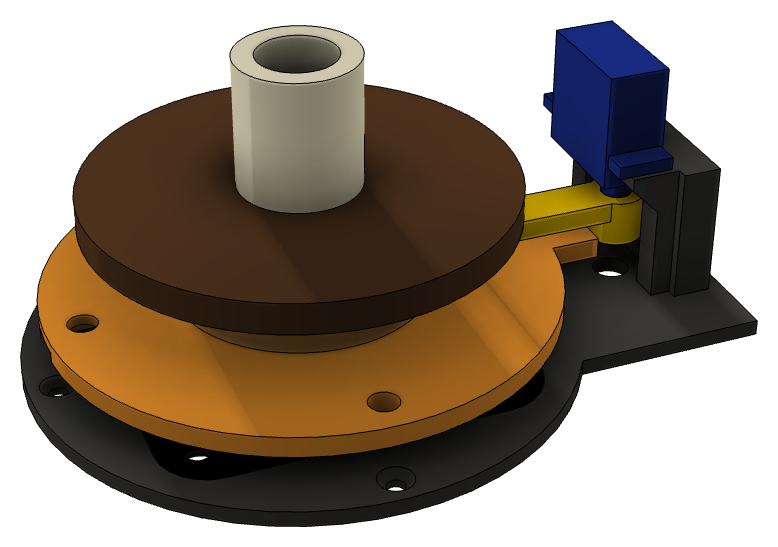

# Nek

Het draaimechanisme onder het plateau van de klok. Een stalen lazy susan van
72 mm draagt de schedel. De draaiservo staat ernaast en duwt met een armpje en
een pen in een sleuf de bovenkant rond. ±30° op de servo geeft ±25° op de
schedel.

Opbouw van onder naar boven: klokbodem → **base** → lazy susan → **cap** →
**schijfafstandhouder** → houten schijf (uit het plateau gezaagd) → wervel van
de schedel. De servo hangt ondersteboven aan de base en steekt door een
uitsparing in het plateau; er staat een kaars op of voor.

## Ontwerp

- [`knekelbeen_nek.f3d`](knekelbeen_nek.f3d): het Fusion-ontwerp, met tijdlijn
  en parameters. De `REF`-onderdelen (lazy susan, servo, pen, houten schijf,
  wervel) zijn alleen ter referentie.
- [`knekelbeen_nek.step`](knekelbeen_nek.step): hetzelfde als STEP.

Parameters (Wijzigen › Parameters wijzigen):

| Parameter | Waarde | Wat |
|---|---|---|
| `base_t` | 3 mm | dikte van de base |
| `brg_h` | 8 mm | hoogte van de lazy susan |
| `cap_t` | 4 mm | dikte van de cap |
| `tab_z` | 29,5 mm | bovenkant van de servohouder = onderkant van het plateau |
| `arm_t` | 4 mm | dikte van de servo-arm |
| `plank_t` | 6 mm | dikte van het plateau (verschuift alleen de referenties) |
| `spline_d` | 4,8 mm | gat voor de servo-as; getest met `spline_fit_test.stl` |
| `ins_m2`, `ins_m3`, `ins_m4` | 3,0 / 4,2 / 5,6 mm | gaten voor de inserts |

## Printen

PLA of PETG, 0,2 mm, 3 à 4 wanden, 25% infill. De STL's liggen al goed;
niets heeft support nodig.

| Bestand | Aantal | Op het bed |
|---|---|---|
| [`stl/base.stl`](stl/base.stl) | 1 | vlakke kant onder |
| [`stl/cap.stl`](stl/cap.stl) | 1 | bovenkant onder |
| [`stl/servo_arm.stl`](stl/servo_arm.stl) | 1 | bovenkant onder, naaf omhoog |
| [`stl/schijf_afstandhouder_14_5mm.stl`](stl/schijf_afstandhouder_14_5mm.stl) | 1 | lijmvlak onder |
| [`stl/vloer_afstandhouder_29_5mm.stl`](stl/vloer_afstandhouder_29_5mm.stl) | 3–4 | rechtop |
| [`stl/spline_fit_test.stl`](stl/spline_fit_test.stl) | 1 | testje: gaten van 4,8 tot 5,2 mm voor de servo-as |

## Inserts en schroeven

| Wat | Aantal | Waarvoor |
|---|---|---|
| Insert M2x3x3.2 | 2 | servohouders in de base |
| Insert M4x4x6 | 3 | cap |
| Insert M3x4x5 | 1 | puntje van de servo-arm |
| M2x6, bolkop | 2 | lipjes van de servo |
| M4x5, bolkop (M4x6 als de lagerplaat dikker is dan 1 mm) | 3 | bovenste lagerplaat aan de cap, van onderaf |
| Houtschroef 3,5–4 × 16 mm, bolkop | 4 | lazy susan + base in de klokbodem |
| M2x6–8, bolkop | 1 | servo-arm op de as, van onderaf door het gat in de base |
| Stelschroef M3x8 | 1 | de pen in de sleuf |
| Houtschroef 3,5 × 16 mm, bolkop | 3–4 | vloerafstandhouders in de klokbodem |

Inserts zetten: 210–230 °C voor PLA, 230–250 °C voor PETG.

## In elkaar zetten

1. Schroef de cap vast op de bovenste plaat van de lazy susan (3× M4 van
   onderaf), terwijl de lazy susan nog los is.
2. Zet de lazy susan met de base op de klokbodem. Draai de cap tot het
   toegangsgat boven een schroefgat ligt en zet de vier houtschroeven.
3. Hang de servo ondersteboven op de houders en schroef de lipjes vast (2× M2).
4. Zet de servo in de middenstand, druk de arm op de as (wijzend naar het
   midden van de lazy susan) en zet hem vast met het hoornschroefje, van onderaf
   door het gat in de base.
5. Draai de cap tot de sleuf onder de insert van de arm ligt. Draai de
   stelschroef erin tot hij gelijk ligt met de bovenkant van de arm. De punt zit
   dan ~2,5 mm in de sleuf en raakt de stalen plaat niet.
6. Lijm de schijfafstandhouder op de cap: het randje valt in het groefje, de
   draaduitgang wijst van de servo af. Lijm de houten schijf erop en de wervel
   daarop.
7. Schroef de vloerafstandhouders vast bij de hoeken van het plateau, minstens
   55 mm van het midden van de lazy susan en buiten het bereik van de arm. Leg
   het plateau er los op; zo kun je er later weer bij.

De kabels uit de schedel gaan door de wervel en de schijf naar beneden en via
de zijuitgang van de afstandhouder onder het plateau weg. Laat ze ruim
genoeg hangen voor ±30°.

## Firmware

Zet het draaibereik op ongeveer 30 (servo ±30° = schedel ±25°). Blijf onder
de 55: daar loopt de pen tegen het eind van de sleuf.

## Anders dan de ontwerpopdracht

[`docs/nek-ontwerp.md`](../docs/nek-ontwerp.md) stelde de servo onder het
lager voor, met de as in het midden. Servo plus hoorntje is ~32 mm hoog, dus de
schedel kwam dan te hoog te staan. Daarom staat de servo naast het lager,
ondersteboven, en steekt hij door het plateau. De lazy susan ligt recht (niet
45° gedraaid) op de base.
